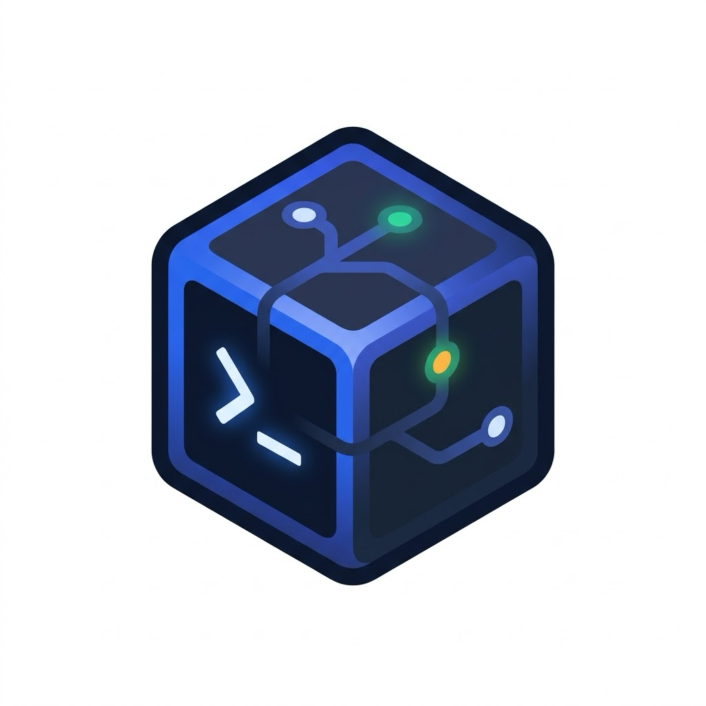
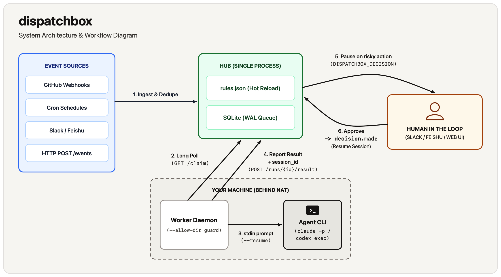

<p align="center">
  
</p>

<h1 align="center">dispatchbox</h1>

<p align="center">
  <strong>Event-driven automation for Claude Code and Codex on your own machines.</strong><br>
  Route webhooks, cron jobs, and chat messages to local coding agents—and pause for human approval only when an action crosses your risk boundary.
</p>

<p align="center">
  <a href="https://github.com/XixianWasTaken/dispatchbox/blob/main/LICENSE"></a>
  
  
</p>

<p align="center">
  <strong>English</strong> · <a href="https://github.com/XixianWasTaken/dispatchbox/blob/main/README.zh-CN.md">简体中文</a> · <a href="https://github.com/XixianWasTaken/dispatchbox/blob/main/docs/README.md">Documentation</a> · <a href="https://github.com/XixianWasTaken/dispatchbox/blob/main/docs/rules.md">Rules Guide</a> · <a href="https://github.com/XixianWasTaken/dispatchbox/blob/main/docs/reference.md">CLI &amp; API Reference</a>
</p>

**dispatchbox** is a lightweight hub-and-worker daemon (~2,700 lines of dependency-free Python) that turns **Claude Code (`claude`)** and **OpenAI Codex CLI (`codex`)** from interactive terminal tools into event-driven background workers running on your own hardware.

Incoming signals—GitHub webhooks, 5-field cron schedules, Slack or Feishu mentions, or any `POST /events` payload—are normalized, deduplicated, and matched against a hot-reloading JSON rules file. Workers on your macOS or Linux machines long-poll the hub over outbound HTTP, execute `claude` or `codex` in allowed local directories using your existing CLI login, and report structured results, token usage, and session IDs.

When an agent reaches an operation you classified as sensitive (such as `delete_data` or `spend_money`), it pauses and sends an interactive decision prompt to Slack, Feishu, or the built-in web dashboard. Clicking an option emits a `decision.made` event; a follow-up rule matching it resumes the same agent session (`claude --resume` / `codex exec resume`), optionally with wider tool permissions to finish the job.

```bash
git clone https://github.com/XixianWasTaken/dispatchbox.git && cd dispatchbox
python3 -m dispatchbox check --rules examples/hello.json
```

## Table of contents

- [Why dispatchbox?](#why-dispatchbox)
- [Quick start (2 minutes)](#quick-start)
- [Installation](#installation)
- [Core capabilities](#core-capabilities)
- [Real-world use cases](#real-world-use-cases)
- [How it works](#how-it-works)
- [Comparison with alternatives](#comparison-with-alternatives)
- [Limitations & trade-offs](#limitations--trade-offs)
- [Security model](#security-model)
- [Documentation](#documentation)
- [Development & contributing](#development--contributing)
- [License](#license)

## Why dispatchbox?

Most developers already have `claude` or `codex` signed in on their workstation with access to local repositories, toolchains, and credentials. Automating those agents on background events usually forces an unpleasant trade-off:

1. **Cloud runners lack your local environment.** Running agents in GitHub Actions or vendor-hosted sandboxes means re-provisioning toolchains and copying secrets into an environment that is not the one you develop in.
2. **Unattended agents are either too risky or too noisy.** Giving a background agent unrestricted `Bash` permissions on your machine is dangerous, while requiring approval on every tool call defeats the purpose of background automation.
3. **Ad-hoc cron scripts and chat wrappers lose context.** Simple shell wrappers around `claude -p` do not deduplicate webhook bursts, serialize concurrent runs on the same branch, detect silent permission failures when a CLI exits `0`, or preserve session state across human approvals.

`dispatchbox` solves all three with a minimal, inspectable architecture:

- **Bring your own machine and CLI subscription**: No model API keys to configure in `dispatchbox`. Workers invoke the stock `claude` and `codex` binaries already installed on your macOS or Linux machines.
- **Two-stage privilege escalation via session resume**: Start runs with narrow, read-only flags (e.g., `--allowed-tools Read,Glob,Grep`). When the agent asks for approval and you confirm, the follow-up rule resumes the same session ID with targeted write permissions (e.g., `Bash(rm:*)`).
- **Outbound-only workers**: Workers pull tasks via `GET /claim` long polling. Your workstation or Mac mini behind home NAT never needs an open inbound port.

## Quick start

**Prerequisites:**
- Python **3.10+** (uses the Python standard library only; no `pip install` required).
- [Claude Code](https://docs.anthropic.com/en/docs/claude-code) (`claude`) or [Codex CLI](https://github.com/openai/codex) (`codex`) installed and signed in (`examples/hello.json` uses `claude`).

### 1. Create a scratch workspace and shared token

From the repository root, create a `./demo` directory with two sample files and generate a `DISPATCHBOX_TOKEN`:

```bash
mkdir -p demo && echo "stale" > demo/old.log && echo "# notes" > demo/notes.md
export DISPATCHBOX_TOKEN="$(python3 -c 'import secrets; print(secrets.token_urlsafe(32))')"
```

### 2. Start the hub

The bundled [`examples/hello.json`](https://github.com/XixianWasTaken/dispatchbox/blob/main/examples/hello.json) defines `require_decision_for: ["delete_data"]` and three rules:
- `ask`: read-only (`--allowed-tools Read,Glob,Grep`)
- `tidy`: read-only initially; must ask before deleting any file
- `after-decision`: triggered on `dispatchbox/decision.made`; resumes the session with `Read,Glob,Grep,Bash(rm:*)`

```bash
python3 -m dispatchbox hub --rules examples/hello.json
```

### 3. Start a local worker

In a **second terminal** (with the same `DISPATCHBOX_TOKEN` exported), start a worker restricted to `./demo`:

```bash
export DISPATCHBOX_TOKEN="<paste-same-token>"
python3 -m dispatchbox worker --name local --allow-dir ./demo
```

### 4. Dispatch two events

In a **third terminal** (with the same `DISPATCHBOX_TOKEN` exported), send a read-only question and a file-deletion request:

```bash
export DISPATCHBOX_TOKEN="<paste-same-token>"
python3 -m dispatchbox send manual ask --summary "What files are here?"
python3 -m dispatchbox send manual tidy --summary "Delete old.log"
```

Both events are routed immediately:

```json
{"event_id": 1, "status": "routed", "runs": [1], "coalesced_into": []}
{"event_id": 2, "status": "routed", "runs": [2], "coalesced_into": []}
```

### 5. Approve the decision and watch the session resume

In the hub terminal log, run `#1` finishes on its own, while run `#2` pauses at the `delete_data` boundary:

```text
NOTIFY [dispatchbox] run #1 ask: succeeded | The directory holds two small files, notes.md and old.log, and nothing else. | Open: /runs/1
NOTIFY [dispatchbox] run #2 tidy: awaiting_decision | Question: Delete old.log from the working directory? | Options: Delete old.log / Keep old.log | Context: Found old.log (6 bytes, modified Nov 3 04:55) in the demo directory next to notes.md; no deletion has been performed. | Open: /runs/2
```

Open **http://127.0.0.1:8787** in your browser, click run **`#2`**, and click **Delete old.log**. Your choice emits a `decision.made` event, queuing run `#3` (`after-decision`), which resumes run `#2`'s Claude session with `Bash(rm:*)` enabled:

```text
NOTIFY [dispatchbox] run #3 after-decision: succeeded | Deleted old.log from the demo directory after owner approval and verified only notes.md remains. | Open: /runs/3
```

## Installation

dispatchbox is on PyPI and has no dependencies:

```bash
pip install dispatchbox          # or: uv tool install dispatchbox
dispatchbox --version
```

The installed `dispatchbox` command is the same as `python3 -m dispatchbox` in the quick start. The quick start runs from a clone because it uses the bundled `examples/hello.json`. To decrypt Feishu events signed with an Encrypt Key, install the optional extra: `pip install "dispatchbox[feishu-encryption]"`.

## Core capabilities

### 1. Multi-source event normalization, deduplication, and coalescing
GitHub webhooks (`pull_request`, `issues`, `issue_comment`, `pull_request_review_comment`, `push`, `workflow_run`), built-in 5-field cron schedules, Slack mentions/DMs, Feishu messages, and `POST /events` calls all normalize into a single event schema (`source`, `type`, `subject`, `summary`, `link`, `payload`, `dedupe_key`).
- **Deduplication**: Repeated events within `dedupe_window` (default `10m`, or `24h` for chat events) are dropped automatically.
- **Coalescing**: When rapid-fire events (e.g., three commits pushed to the same PR or follow-up comments) match a rule while a run for the same `group` is still `queued`, they merge into that queued run so the agent handles the full batch in one pass.

### 2. Policy-gated human-in-the-loop with session continuation
Instead of approving individual bash commands, you declare high-level risk categories in `require_decision_for` (e.g., `["delete_data", "spend_money", "send_external_message"]`).
- When an agent hits one of those boundaries, it outputs a structured `DISPATCHBOX_DECISION:` line and exits cleanly.
- The hub transitions the run to `awaiting_decision` and renders interactive option buttons in Slack, Feishu, or the web UI.
- Recording a decision emits a `dispatchbox/decision.made` event carrying the run's `run_id` and `session_id`. If a rule matches that event (like `after-decision` in the examples), its run invokes `claude --resume <session_id>` or `codex exec resume <session_id>`, keeping the agent's context while applying that rule's tool flags. Without such a rule, nothing happens after the decision.
- **Standing memory**: Configure `"memory": ["DECISIONS.md", "WONT_DO.md"]` so agents read prior owner rulings before asking repetitive questions.

### 3. Pull-based workers with directory and concurrency guards
- **NAT-friendly**: Workers poll `GET /claim` over outbound HTTP/HTTPS. Run the hub on a small VPS or behind a Cloudflare Tunnel while workers run on your local workstation, build server, or laptop.
- **Directory allowlisting**: Workers enforce `--allow-dir` (repeatable) and refuse any rule whose `cwd` resolves outside allowed paths (exit code `126`).
- **Process and secret hygiene**: Prompts are piped via `stdin` (never exposed in `ps` process arguments), `DISPATCHBOX_TOKEN` is stripped from the child environment, and timed-out process groups are terminated cleanly (`SIGTERM` then `SIGKILL`).
- **Group serialization & concurrency**: Runs sharing a `group` key (default `{rule}:{subject}`) never execute concurrently, preventing git index locks or race conditions on the same repo/PR, while `concurrency` caps parallel runs per rule across all workers.

### 4. Honest status reporting, usage accounting, and automatic retries
- **Agent verdict over exit code**: When a coding agent is blocked by `--allowed-tools` or sandbox flags, the CLI process often still exits `0`. `dispatchbox` requires agents to emit `DISPATCHBOX_STATUS: succeeded | failed` and marks a run `failed` if either the exit code is non-zero or the agent reports `failed`.
- **Cost & token tracking**: Parses `claude -p --output-format json` (capturing `total_cost_usd`, fresh + cached input tokens, and output tokens) and `codex exec --json` (capturing `input_tokens` and `output_tokens`).
- **Heartbeat reaping & retries**: Workers send heartbeats every 20 seconds. If a worker goes silent for >120 seconds, the hub marks the run `lost` and (if `retries > 0`) re-queues it with a prompt warning that a prior attempt may have partially completed the task.

### 5. Thread-aware Slack and Feishu chat-ops
- Mention the bot or DM it in **Slack** or **Feishu (飞书)** to trigger a run.
- Enforce strict user access via hot-reloaded `allowed_users` (who can trigger runs) and `approvers` (who can click decision buttons).
- Replies, decision cards, and post-decision follow-up answers stay in the originating chat thread, with internal `DISPATCHBOX_*` protocol markers stripped automatically.

## Real-world use cases

[`rules.example.json`](https://github.com/XixianWasTaken/dispatchbox/blob/main/rules.example.json) contains example rules to adapt. Replace its placeholder worker names (`m4`, `m5`), paths and sources with your own:

1. **Automated read-only PR reviews (`codex`)**: Trigger on `github` `pr.opened` / `pr.synchronize`, run `codex` with `-s read-only` in your local checkout, and post actionable bug reports via `gh pr review`.
2. **Self-healing CI failures (`claude`)**: Trigger on `github` `ci.failure`, route to a specific build machine (`"worker": "m4"`), allow `Bash(git:*),Bash(gh:*),Bash(npm test:*)`, and let Claude inspect logs and push a fix to the failing branch.
3. **Two-stage destructive maintenance (a pattern to write yourself)**: Give a `cron` rule read-only `args` and list `delete_data` in `require_decision_for`, so the agent finds stale resources and asks first; approve from Slack or Feishu, and an `after-decision` rule resumes the session with delete permissions. `rules.example.json` does not include this; its `nightly-cleanup` rule runs weekly without an approval step. [`examples/hello.json`](https://github.com/XixianWasTaken/dispatchbox/blob/main/examples/hello.json) shows the same two-stage pattern on a small scale (`tidy`, then `after-decision`).
4. **Test rules before running**: Validate your configuration and dry-run event matching from the CLI:
   ```bash
   python3 -m dispatchbox check --rules rules.example.json --source github --type ci.failure --subject me/app:main
   # ok: 7 rules, 1 schedules, dedupe window 600s
   # matches: ci-failed
   ```

## How it works

<p align="center">
  
</p>

1. **Ingest & Match**: The hub receives an event, checks `dedupe_key` against the SQLite `events` table, evaluates `rules.json` in order, and either coalesces the event into an existing `queued` run or inserts a new `queued` run.
2. **Claim & Render**: A worker matching the rule's `worker` glob pattern and `runner` capability claims the run via `GET /claim`. The hub renders the prompt template (`{subject}`, `{summary}`, `{payload.*}`), appends trigger metadata, standing `memory` file instructions, and the `DISPATCHBOX_*` reporting contract.
3. **Execute & Parse**: The worker verifies `cwd` is inside `--allow-dir`, spawns `claude`, `codex`, or `/bin/sh`, streams heartbeats every 20s, and parses the CLI's JSON output for the final response, `session_id`, token counts, and cost.
4. **Decide & Resume**: If the output contains `DISPATCHBOX_DECISION: {...}`, the run enters `awaiting_decision`. When an authorized user selects an option (via Web UI, Slack, Feishu, or `POST /runs/{id}/decision`), the hub records the choice and emits a `dispatchbox/decision.made` event. A rule matching that event queues a follow-up run with the original run as its parent, and the worker resumes the parent's `session_id`.

See [Architecture](https://github.com/XixianWasTaken/dispatchbox/blob/main/docs/architecture.md) for the sequence diagram, SQLite schema, and module breakdown.

## Comparison with alternatives

| Approach | Where it excels | What dispatchbox does differently |
|---|---|---|
| **[Claude Code GitHub Actions](https://docs.anthropic.com/en/docs/claude-code/github-actions)** | Running Claude on GitHub-hosted runners for GitHub repo events | Runs on **your own machines** with local toolchains and signed-in CLIs; supports **Codex**, cron, Slack, Feishu, and custom HTTP events; supports mid-task **decision pause & session resume** |
| **Chat-only agent bots** (Slack/Discord wrappers) | Interactive Q&A with a local agent from a chat channel | Handles non-chat sources (webhooks, cron, HTTP); provides **deduplication, event coalescing, group serialization, and per-rule concurrency**; supports both Slack and Feishu |
| **Agent orchestration SDKs** (LangGraph, custom Python/TS) | Building bespoke agents with fine-grained programmatic tool hooks | **Zero code to write**; orchestrates unmodified `claude` and `codex` CLIs via a declarative JSON rules file |
| **General workflow engines** (n8n, Zapier, cron scripts) | Connecting SaaS APIs or running stateless shell scripts | Purpose-built for coding agents: **outbound long-polling workers**, `stdin` prompt piping, **session ID resumption**, agent verdict parsing (`DISPATCHBOX_STATUS`), and token/cost tracking |
| **Cloud background agents** (Devin, hosted coding sandboxes) | Fully managed cloud execution without local hardware | **Self-hosted and zero-dependency**: code, credentials, and execution stay on your hardware |

**When to use dispatchbox:**
You already use Claude Code or Codex locally, want them to react automatically to webhooks, schedules, or chat messages on your own machines, and want human approval strictly at high-risk boundaries.

**When not to use dispatchbox:**
You need multi-node high availability, multi-tenant isolation across untrusted users, a built-in VM/container sandbox, or a drag-and-drop visual workflow builder.

## Limitations & trade-offs

- **Single-process hub**: State lives in one local SQLite database (`WAL` mode). There is no multi-node clustering or automatic failover.
- **Public HTTPS required for Slack and Feishu**: Both chat platforms deliver events and button callbacks via HTTP webhooks (`POST /hooks/slack`, `POST /hooks/feishu`), requiring a reverse proxy or tunnel (e.g., `cloudflared`). Slack Socket Mode and Feishu WebSocket long connections are not supported yet.
- **Prompt-level reporting contract**: `DISPATCHBOX_DECISION`, `DISPATCHBOX_STATUS`, and `DISPATCHBOX_SUMMARY` rely on the agent following prompt instructions. If an agent exits `0` without printing a status line, the hub treats the run as `succeeded`.
- **CLI JSON format coupling**: `dispatchbox` parses `claude -p --output-format json` and `codex exec --json`. Breaking upstream changes to those CLI flags or JSON schemas require updating `dispatchbox/worker.py`.
- **No built-in OS sandbox**: `dispatchbox` enforces `--allow-dir` for the working directory, but sandboxing the agent's actions relies on the flags you pass in `args` (such as Claude's `--allowed-tools` or Codex's `-s read-only`) and the OS user account running the worker.

## Security model

A worker executes coding agents on your machine under your OS user account. Keep these essentials in mind:

- **Protect `DISPATCHBOX_TOKEN`**: The bearer token authorizes queueing events and claiming tasks. Treat it like an SSH key.
- **Apply least privilege per rule**: Always restrict initial rules using `--allowed-tools` (Claude) or `-s read-only` / `-s workspace-write` (Codex) in `args`. Grant broader permissions only in follow-up rules triggered after human approval (`decision.made`).
- **Treat event payloads as untrusted input**: Public GitHub issues, PR descriptions, and chat messages are injected into prompts. Never give rules triggered by untrusted external events unrestricted shell or write access.
- **Lock down public hubs**: Always pass `--public-url https://...` when exposing the hub behind a reverse proxy or tunnel so the web dashboard enforces token authentication on every request.

Read **[SECURITY.md](https://github.com/XixianWasTaken/dispatchbox/blob/main/SECURITY.md)** before exposing the hub to a network.

## Documentation

| Guide | What it covers |
|---|---|
| **[Documentation Index](https://github.com/XixianWasTaken/dispatchbox/blob/main/docs/README.md)** | Overview of all guides, example configs, and project roadmap |
| **[Rules, Events & Decisions](https://github.com/XixianWasTaken/dispatchbox/blob/main/docs/rules.md)** | Complete `rules.json` schema, event normalization, GitHub webhook mapping, templating, cron syntax, decisions, and retries |
| **[Slack & Feishu Integration](https://github.com/XixianWasTaken/dispatchbox/blob/main/docs/chat.md)** | Step-by-step app setup, permissions, signature/encryption verification, allowlists, and interactive cards |
| **[Deployment Guide](https://github.com/XixianWasTaken/dispatchbox/blob/main/docs/deployment.md)** | Single-machine vs. remote-hub topologies, `launchd` (macOS) and `systemd` (Linux) service templates, GitHub webhooks, and SQLite backups |
| **[CLI & API Reference](https://github.com/XixianWasTaken/dispatchbox/blob/main/docs/reference.md)** | All `dispatchbox` subcommands (`hub`, `worker`, `send`, `check`), environment variables, HTTP API endpoints, and run states |
| **[Architecture](https://github.com/XixianWasTaken/dispatchbox/blob/main/docs/architecture.md)** | Internal design decisions, request lifecycle, SQLite data model, and module breakdown |
| **[Troubleshooting](https://github.com/XixianWasTaken/dispatchbox/blob/main/docs/troubleshooting.md)** | Common exit codes (`124`, `126`, `127`), webhook signature errors, TLS certificate fixes, and stuck runs |

## Development & contributing

Run the full test suite (unit tests, end-to-end hub/worker tests with a scripted fake `claude` binary, and Slack/Feishu tests against a local mock API server) using Python's built-in test runner:

```bash
python3 -m unittest discover -s tests -t . -v
```

Validate rule files at any time:

```bash
python3 -m dispatchbox check --rules examples/hello.json
python3 -m dispatchbox check --rules rules.example.json
```

Contributions are welcome! Please read **[CONTRIBUTING.md](https://github.com/XixianWasTaken/dispatchbox/blob/main/CONTRIBUTING.md)** for our design principles (stdlib-only core, thin over clever, safe by default) and instructions for adding new adapters.

## License

Released under the [MIT License](https://github.com/XixianWasTaken/dispatchbox/blob/main/LICENSE).
