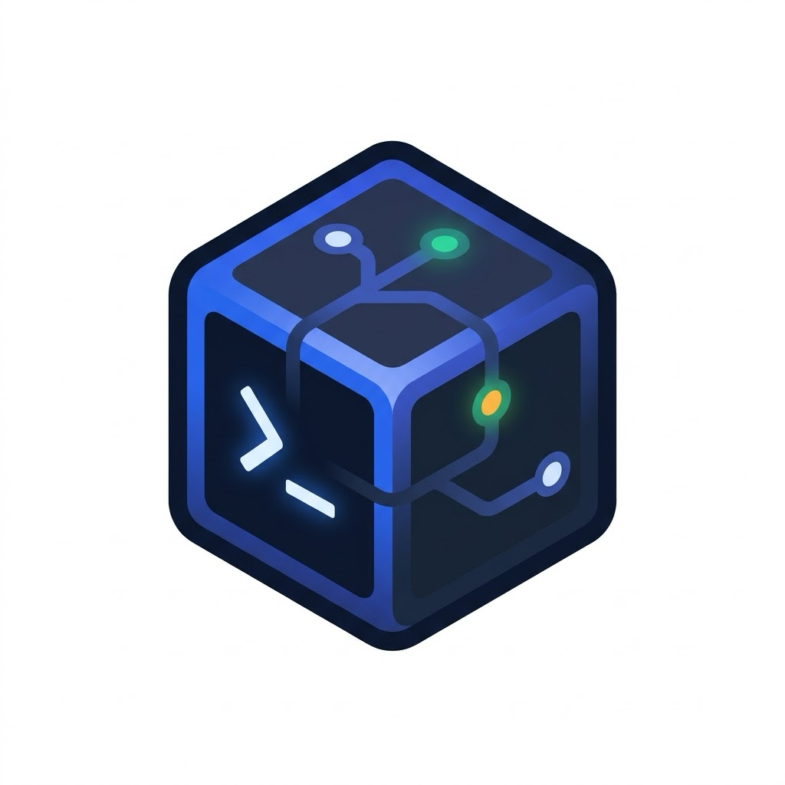
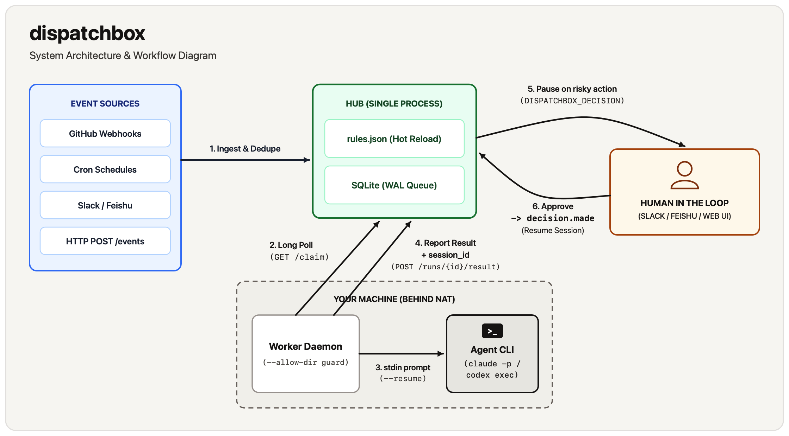

<p align="center">
  
</p>

<h1 align="center">dispatchbox</h1>

<p align="center">
  <strong>在你自己的机器上，用事件驱动 Claude Code 和 Codex 自动运行。</strong><br>
  将 Webhook、Cron 定时任务和聊天消息路由给本地编码 Agent——仅在触及你设定的高风险操作边界时暂停并请求人工审批。
</p>

<p align="center">
  <a href="LICENSE"></a>
  
  
</p>

<p align="center">
  <a href="README.md">English</a> · <strong>简体中文</strong> · <a href="docs/README.md">Documentation</a> · <a href="docs/rules.md">Rules Guide</a> · <a href="docs/reference.md">CLI &amp; API Reference</a>
</p>

**dispatchbox** 是一个轻量级的 Hub + Worker 守护进程（约 2,700 行纯 Python 标准库代码，零第三方运行时依赖），用于将 **Claude Code (`claude`)** 和 **OpenAI Codex CLI (`codex`)** 从交互式终端工具转化为运行在你自己硬件上的事件驱动后台任务系统。

来自 GitHub Webhook、五段式 Cron 定时计划、Slack 或飞书（Feishu）消息以及任意 `POST /events` 请求的信号会被统一标准化、去重，并与支持热重载的 JSON 规则文件进行匹配。运行在你 macOS 或 Linux 机器上的 Worker 通过出站 HTTP 长轮询从 Hub 领取任务，在你允许的本地目录中调用已登录的 `claude` 或 `codex` CLI，并回传结构化结果、Token 用量、费用和会话 ID。

当 Agent 遇到你列为敏感类别的操作（例如 `delete_data` 或 `spend_money`）时，它会暂停执行，并向 Slack、飞书或内置 Web 控制台发送带交互按钮的审批请求。点击按钮后，系统会生成一条 `decision.made` 事件；匹配它的后续规则会接续同一个 Agent 会话（`claude --resume` / `codex exec resume`），并可按需赋予更高权限以完成后续操作。

```bash
git clone https://github.com/XixianWasTaken/dispatchbox.git && cd dispatchbox
python3 -m dispatchbox check --rules examples/hello.json
```

## 目录

- [为什么需要 dispatchbox？](#为什么需要-dispatchbox)
- [2 分钟快速开始](#快速开始)
- [安装](#安装)
- [核心能力](#核心能力)
- [典型使用场景](#典型使用场景)
- [工作原理](#工作原理)
- [与现有方案对比](#与现有方案对比)
- [局限性与设计取舍](#局限性与设计取舍)
- [安全模型](#安全模型)
- [文档导航](#文档导航)
- [开发与贡献](#开发与贡献)
- [许可证](#许可证)

## 为什么需要 dispatchbox？

许多开发者已经在本地工作站登录了 `claude` 或 `codex`，并配好了本地代码库、编译工具链和访问凭据。但想让这些 Agent 自动响应后台事件时，往往面临两难：

1. **云端 Runner 缺少你的本地环境**：在 GitHub Actions 或云端托管沙箱里跑 Agent，意味着要在一个并非你日常开发的环境里重新配置工具链、搬运密钥。
2. **全自动 Agent 要么太危险，要么太吵**：给后台 Agent 开放无限制的本地 `Bash` 权限风险极高；但如果每次调用工具都要人工确认，又失去了后台自动化的意义。
3. **简单的定时脚本或聊天机器人缺乏编排能力**：用简单的 Shell 脚本包装 `claude -p`，无法对短时间内的 Webhook 洪峰去重或合并，无法避免同一分支上的并发冲突，无法识别“权限被拒但进程退出码仍为 0”的假成功，也无法在人工审批后恢复原会话上下文。

`dispatchbox` 用极简、透明的架构解决上述问题：

- **复用你现有的机器与 CLI 账号**：无需在 `dispatchbox` 中配置模型 API Key，直接调用你机器上已安装并登录的 `claude` 和 `codex` 命令行工具。
- **基于会话续跑的两阶段权限升级**：初始任务可使用严格的只读权限（如 `--allowed-tools Read,Glob,Grep`）。当 Agent 发起提问并获得你的批准后，后续规则会恢复同一个会话 ID，并按需开放写/删除权限（如 `Bash(rm:*)`）。
- **纯出站连接的 Worker**：Worker 通过 `GET /claim` 长轮询主动拉取任务。位于家庭 NAT 或防火墙后的笔记本电脑、Mac mini 无需暴露任何入站端口即可作为执行节点。

## 快速开始

**前置条件：**
- Python **3.10+**（仅使用 Python 标准库，无需 `pip install` 任何依赖）。
- 已安装并登录 [Claude Code](https://docs.anthropic.com/en/docs/claude-code) (`claude`) 或 [Codex CLI](https://github.com/openai/codex) (`codex`)。内置的 `examples/hello.json` 使用 `claude`；如果用 Codex，把下面命令里的规则文件换成 [`examples/hello-codex.json`](examples/hello-codex.json)。

### 1. 创建演示目录与共享 Token

在仓库根目录下创建一个包含两个示例文件的 `./demo` 目录，并生成 `DISPATCHBOX_TOKEN`：

```bash
mkdir -p demo && echo "stale" > demo/old.log && echo "# notes" > demo/notes.md
export DISPATCHBOX_TOKEN="$(python3 -c 'import secrets; print(secrets.token_urlsafe(32))')"
```

### 2. 启动 Hub

仓库自带的 [`examples/hello.json`](examples/hello.json) 配置了 `require_decision_for: ["delete_data"]` 以及三条规则：
- `ask`：仅允许只读工具（`--allowed-tools Read,Glob,Grep`）
- `tidy`：初始仅只读，删除任何文件前必须发起审批
- `after-decision`：匹配 `dispatchbox/decision.made` 事件，在批准后携带 `Read,Glob,Grep,Bash(rm:*)` 权限续跑原会话

```bash
python3 -m dispatchbox hub --rules examples/hello.json
```

### 3. 启动本地 Worker

打开**第二个终端**（导出相同的 `DISPATCHBOX_TOKEN`），启动一个仅允许在 `./demo` 目录内执行的 Worker：

```bash
export DISPATCHBOX_TOKEN="<粘贴同一个-token>"
python3 -m dispatchbox worker --name local --allow-dir ./demo
```

### 4. 发送两条测试事件

打开**第三个终端**（导出相同的 `DISPATCHBOX_TOKEN`），分别发送一个只读提问和一个删除文件请求：

```bash
export DISPATCHBOX_TOKEN="<粘贴同一个-token>"
python3 -m dispatchbox send manual ask --summary "What files are here?"
python3 -m dispatchbox send manual tidy --summary "Delete old.log"
```

两条事件会立即被路由：

```json
{"event_id": 1, "status": "routed", "runs": [1], "coalesced_into": []}
{"event_id": 2, "status": "routed", "runs": [2], "coalesced_into": []}
```

### 5. 批准操作并观察会话续跑

在 Hub 终端日志中，你会看到 run `#1` 直接执行成功，而 run `#2` 在触及 `delete_data` 边界时暂停并请求决策：

```text
NOTIFY [dispatchbox] run #1 ask: succeeded | The directory holds two small files, notes.md and old.log, and nothing else. | Open: /runs/1
NOTIFY [dispatchbox] run #2 tidy: awaiting_decision | Question: Delete old.log from the working directory? | Options: Delete old.log / Keep old.log | Context: Found old.log (6 bytes, modified Nov 3 04:55) in the demo directory next to notes.md; no deletion has been performed. | Open: /runs/2
```

在浏览器打开 **http://127.0.0.1:8787**，点开 run **`#2`** 并点击 **Delete old.log** 按钮。你的选择会触发一条 `decision.made` 事件并启动 run `#3`（`after-decision`），接着 run `#2` 的 Claude 会话继续执行 `rm`：

```text
NOTIFY [dispatchbox] run #3 after-decision: succeeded | Deleted old.log from the demo directory after owner approval and verified only notes.md remains. | Open: /runs/3
```

## 安装

dispatchbox 已发布到 PyPI，没有任何依赖：

```bash
pip install dispatchbox          # 或：uv tool install dispatchbox
dispatchbox --version
```

安装后的 `dispatchbox` 命令等同于快速开始里的 `python3 -m dispatchbox`。快速开始之所以从克隆的仓库运行，是因为要用到仓库自带的 `examples/hello.json`。如果飞书应用设置了 Encrypt Key，需要安装可选依赖来解密事件：`pip install "dispatchbox[feishu-encryption]"`。

## 核心能力

### 1. 多源事件标准化、去重与排队合并（Coalescing）
GitHub Webhook（`pull_request`、`issues`、`issue_comment`、`pull_request_review_comment`、`push`、`workflow_run`）、内置五段式 Cron 定时任务、Slack @提及与私聊、飞书单聊与群聊 @消息，以及任意 `POST /events` 请求都会转换为统一的事件结构（`source`、`type`、`subject`、`summary`、`link`、`payload`、`dedupe_key`）。
- **自动去重**：在 `dedupe_window`（默认 `10m`，聊天消息为 `24h`）内重复到达的相同 `dedupe_key` 事件会被直接忽略。
- **排队合并**：当同一分组（`group`）的某个 Run 仍处于 `queued` 排队状态时，后续到达的同类事件会自动并入该 Run，让 Agent 一次性处理完整上下文，避免重复启动。

### 2. 策略驱动的人在回路（Human-in-the-Loop）与会话恢复
无需对每条 Shell 命令逐一放行，只需在 `require_decision_for` 中声明需要人工把关的操作类别（如 `["delete_data", "spend_money", "send_external_message"]`）。
- 当 Agent 遇到上述操作时，会按约定输出一行 `DISPATCHBOX_DECISION:` JSON 并暂停。
- Hub 将该 Run 标记为 `awaiting_decision`，并在 Slack、飞书或 Web 控制台渲染交互按钮。
- 做出选择后，Hub 生成一条携带该 Run 的 `run_id` 和 `session_id` 的 `dispatchbox/decision.made` 事件。如果有规则匹配它（例如示例中的 `after-decision`），新 Run 会通过 `claude --resume <session_id>` 或 `codex exec resume <session_id>` 恢复原会话上下文，并应用该规则的权限参数。没有这样的规则，决策之后什么都不会发生。
- **长期决策记忆**：支持配置 `"memory": ["DECISIONS.md", "WONT_DO.md"]`，提示 Agent 在提问前先查阅你已记录的长期决定。

### 3. 出站拉取式 Worker、目录白名单与并发控制
- **穿透内网 NAT**：Worker 通过出站 HTTP/HTTPS 长轮询 `GET /claim`，可在小型云主机或 Cloudflare Tunnel 后运行 Hub，在家用电脑、笔记本或内网开发机上运行 Worker。
- **严格目录白名单**：Worker 强制校验 `--allow-dir`（支持多次指定），任何 `cwd` 超出允许目录范围的任务都会被直接拒绝（退出码 `126`）。
- **进程与凭据处理**：提示词通过 `stdin` 传入（不会暴露在 `ps` 命令行参数中），子进程环境变量会自动剥离 `DISPATCHBOX_TOKEN`，超时任务会按进程组安全终止（先 `SIGTERM` 后 `SIGKILL`）。
- **分组串行与规则并发**：相同 `group`（默认 `{rule}:{subject}`）的任务绝不会并发执行，防止同一代码库或 PR 出现冲突；同时支持通过 `concurrency` 限制单条规则的全局最大并发数。

### 4. 真实状态判定、用量统计与断线重试
- **综合进程退出码与 Agent 自报状态**：当 Agent 因权限受限无法完成任务时，CLI 进程往往仍以 `0` 退出。`dispatchbox` 要求 Agent 输出 `DISPATCHBOX_STATUS: succeeded | failed`，只要退出码非零或 Agent 自报 `failed`，Run 均会被准确标记为 `failed`。
- **费用与 Token 统计**：自动解析 `claude -p --output-format json`（记录美元费用、含缓存的输入 Token 与输出 Token）以及 `codex exec --json`（记录输入与输出 Token）。
- **心跳监控与丢失重试**：Worker 每 20 秒发送心跳。若超过 120 秒无响应，Hub 将任务标记为 `lost`；若配置了 `retries > 0`，会自动重新排队并在提示词中提醒 Agent 检查上一次尝试是否已完成部分工作。

### 5. 保持线程上下文的 Slack 与飞书集成
- 在 **Slack** 或 **飞书（Feishu）** 中 @机器人或私聊即可发起任务。
- 通过实时生效的 `allowed_users`（允许发起任务的用户 ID）和 `approvers`（允许点击审批按钮的用户 ID）严格控制权限。
- 执行结果、审批卡片及审批后的续跑回复均留在原聊天线程中，并自动剥离底层的 `DISPATCHBOX_*` 标记行。

## 典型使用场景

[`rules.example.json`](rules.example.json) 提供了可参考修改的示例规则，使用前请把其中的占位 Worker 名（`m4`、`m5`）、路径和来源换成你自己的：

1. **自动只读 PR 代码审查（`codex`）**：监听 `github` 的 `pr.opened` / `pr.synchronize` 事件，在本地仓库以 `codex -s read-only` 运行审查，并通过 `gh pr review` 提交真正会导致 Bug 的问题。
2. **CI 失败自动修复（`claude`）**：监听 `github` 的 `ci.failure` 事件，路由到指定构建机（`"worker": "m4"`），开放 `Bash(git:*),Bash(gh:*),Bash(npm test:*)`，定位原因并推送修复提交。
3. **两阶段高风险清理（需要自己编写规则）**：给 `cron` 规则配置只读的 `args`，并把 `delete_data` 写进 `require_decision_for`，让 Agent 先巡检、发现过期资源后发起审批；你在飞书或 Slack 上批准后，由 `after-decision` 规则带着删除权限续跑会话。`rules.example.json` 里没有这条规则，其中的 `nightly-cleanup` 每周运行一次，且不经过审批。[`examples/hello.json`](examples/hello.json) 用小规模演示了同样的两阶段模式（`tidy` 之后是 `after-decision`）。
4. **命令行验证规则匹配**：在启动服务前，随时用 `check` 子命令校验规则语法并模拟事件匹配：
   ```bash
   python3 -m dispatchbox check --rules rules.example.json --source github --type ci.failure --subject me/app:main
   # ok: 7 rules, 1 schedules, dedupe window 600s
   # matches: ci-failed
   ```

## 工作原理

<p align="center">
  
</p>

1. **接收与匹配**：Hub 接收事件，通过 SQLite `events` 表校验 `dedupe_key`，按顺序匹配 `rules.json`，将事件并入正在排队的同类 Run 或创建新的 `queued` Run。
2. **领取与渲染**：名称和 Runner 匹配的空闲 Worker 通过 `GET /claim` 领走任务。Hub 渲染提示词模板（`{subject}`、`{summary}`、`{payload.*}`），并追加触发上下文、`memory` 长期决策文件读取指令以及 `DISPATCHBOX_*` 回报契约。
3. **执行与解析**：Worker 校验 `cwd` 位于 `--allow-dir` 白名单内，启动 `claude`、`codex` 或 `/bin/sh`，每 20 秒发送心跳，并解析 CLI 的 JSON 输出以提取回复正文、`session_id`、Token 用量与费用。
4. **决策与续跑**：若输出包含 `DISPATCHBOX_DECISION: {...}`，Run 进入 `awaiting_decision` 状态。授权用户做出选择后，Hub 生成一条 `dispatchbox/decision.made` 事件。匹配它的规则会排入一个以原 Run 为父任务的后续 Run，Worker 用父任务的 `session_id` 续跑。

详见 [Architecture](docs/architecture.md)。

## 与现有方案对比

| 方案类型 | 擅长场景 | dispatchbox 的差异化价值 |
|---|---|---|
| **[Claude Code GitHub Actions](https://docs.anthropic.com/en/docs/claude-code/github-actions)** | 在 GitHub 官方 Runner 上响应 GitHub 仓库事件运行 Claude | 运行在**你自己的机器与本地环境**上；同时支持 **Codex**、Cron、Slack、飞书和自定义 HTTP 事件；支持**中途暂停审批并恢复原会话** |
| **聊天机器人封装工具**（Slack/Discord 包装器） | 在聊天窗口与本地 Agent 交互问答 | 支持聊天以外的事件源（Webhook、Cron、HTTP）；内置**事件去重、排队合并、分组串行与并发限制**；原生支持飞书与 Slack |
| **Agent 编排框架 / SDK**（LangGraph 等） | 用代码编写自定义 Agent 与细粒度工具拦截逻辑 | **零代码接入**；通过声明式 JSON 规则直接编排原生的 `claude` 与 `codex` CLI |
| **通用工作流引擎**（n8n、Zapier、Cron 脚本） | 连接 SaaS API 或执行无状态脚本 | 专为编码 Agent 设计：**出站长轮询 Worker**、`stdin` 提示词传递、**跨审批会话恢复**、Agent 状态自检（`DISPATCHBOX_STATUS`）与费用统计 |
| **云端托管后台 Agent** | 免本地硬件的全托管云端执行 | **自托管、零外部依赖**：代码、密钥和运行环境完全留在你自己的机器上 |

**适合使用 dispatchbox 的场景：**
你已经在本地使用 Claude Code 或 Codex，希望它们在你的机器上自动响应代码库事件、定时任务或聊天指令，并且只在触及特定高风险动作时由你把关。

**不适合使用 dispatchbox 的场景：**
你需要多节点高可用集群、面向多租户的强安全隔离、脱离 Agent CLI 自身的底层虚拟机/容器沙箱，或者拖拽式可视化工作流构建器。

## 局限性与设计取舍

- **单进程 Hub**：所有状态保存在单个本地 SQLite 数据库（`WAL` 模式）中，不支持多实例集群或自动故障转移。
- **Slack 与飞书接入需要公网 HTTPS 地址**：两个平台均通过 Webhook 回调（`POST /hooks/slack`、`POST /hooks/feishu`）推送消息和按钮点击事件，需配合反向代理或隧道（如 `cloudflared`）使用，暂不支持 Socket Mode 或长连接模式。
- **基于提示词的汇报契约**：`DISPATCHBOX_DECISION`、`DISPATCHBOX_STATUS` 和 `DISPATCHBOX_SUMMARY` 依赖模型遵守提示词指令。若进程退出码为 `0` 且未输出状态行，Hub 会将其视为 `succeeded`。
- **依赖 Agent CLI 的 JSON 输出格式**：Worker 解析 `claude -p --output-format json` 与 `codex exec --json`，若上游 CLI 发生破坏性格式变更，需同步更新 `dispatchbox/worker.py`。
- **自身不提供额外系统级沙箱**：`dispatchbox` 负责限制工作目录（`--allow-dir`），但 Agent 的具体工具权限由你在规则 `args` 中传入的参数（如 `--allowed-tools` 或 `-s read-only`）及运行 Worker 的系统账户决定。

## 安全模型

Worker 以你的操作系统用户身份在本地执行 Agent。请务必遵循以下安全原则：

- **妥善保管 `DISPATCHBOX_TOKEN`**：持有该 Token 即可向 Hub 投递事件并在 Worker 上领取任务，请像保护 SSH 私钥一样保护它。
- **遵循最小权限原则**：在初始规则的 `args` 中始终使用 `--allowed-tools`（Claude）或 `-s read-only` / `-s workspace-write`（Codex）收紧权限，仅在人工审批通过后的 `decision.made` 续跑规则中开放必要的高风险工具。
- **将外部事件内容视为不可信输入**：公开仓库的 Issue、PR 描述及评论会进入提示词。切勿为不可信外部事件触发的规则授予无限制的写文件或 Shell 权限。
- **公网暴露必设 `--public-url`**：当通过反向代理或隧道将 Hub 暴露到公网时，必须指定 `--public-url https://...`，确保 Web 控制台对所有请求强制要求 Token 登录。

将 Hub 暴露到网络前，请完整阅读 **[SECURITY.md](SECURITY.md)**。

## 文档导航

详细专题文档位于 [`docs/`](docs/README.md) 目录（英文）：

- **[Documentation Index](docs/README.md)**：文档总览、示例文件说明与开发路线图
- **[Rules, Events & Decisions](docs/rules.md)**：`rules.json` 完整字段说明、事件格式、GitHub Webhook 映射、模板变量、Cron 语法、审批流与重试机制
- **[Slack & Feishu Integration](docs/chat.md)**：Slack 与飞书自建应用配置步骤、权限清单、签名与加密校验、白名单及交互卡片
- **[Deployment Guide](docs/deployment.md)**：单机与跨机部署拓扑、macOS `launchd` 与 Linux `systemd` 开机自启模板、GitHub Webhook 接入及备份升级
- **[CLI & API Reference](docs/reference.md)**：命令行参数（`hub`、`worker`、`send`、`check`）、环境变量、HTTP API 接口及 Run 状态说明
- **[Architecture](docs/architecture.md)**：架构设计取舍、完整生命周期时序图、SQLite 表结构与代码模块划分
- **[Troubleshooting](docs/troubleshooting.md)**：常见退出码（`124`、`126`、`127`）、Webhook 签名报错、TLS 证书缺失与任务卡住的排查方法

## 开发与贡献

使用 Python 内置的 `unittest` 即可运行完整测试套件（包含单元测试、使用模拟 `claude` 脚本的端到端 Hub/Worker 测试，以及针对本地模拟 API 的 Slack/飞书集成测试）：

```bash
python3 -m unittest discover -s tests -t . -v
```

校验规则文件有效性：

```bash
python3 -m dispatchbox check --rules examples/hello.json
python3 -m dispatchbox check --rules rules.example.json
```

欢迎提交 Issue 和 Pull Request！参与贡献前请阅读 **[CONTRIBUTING.md](CONTRIBUTING.md)**。

## 许可证

基于 [MIT License](LICENSE) 开源。
