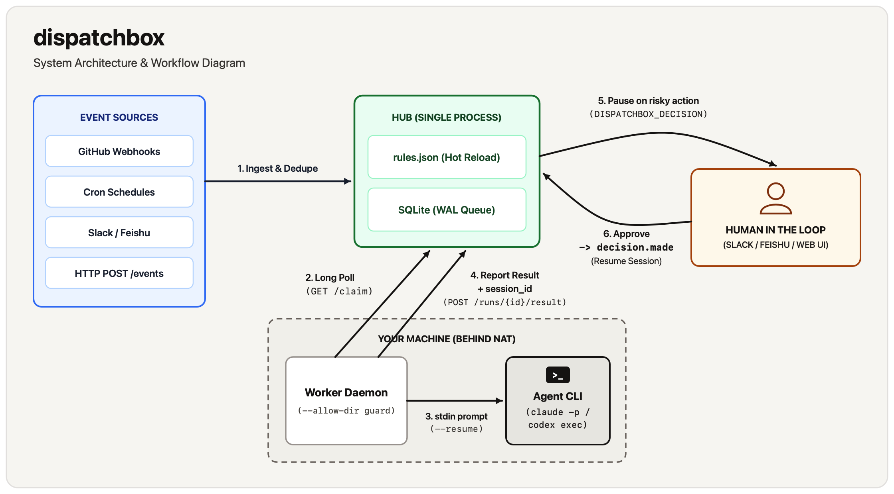
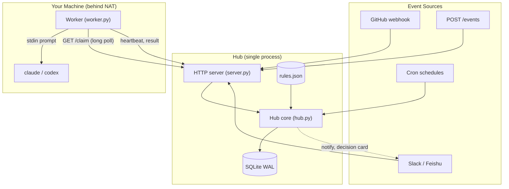
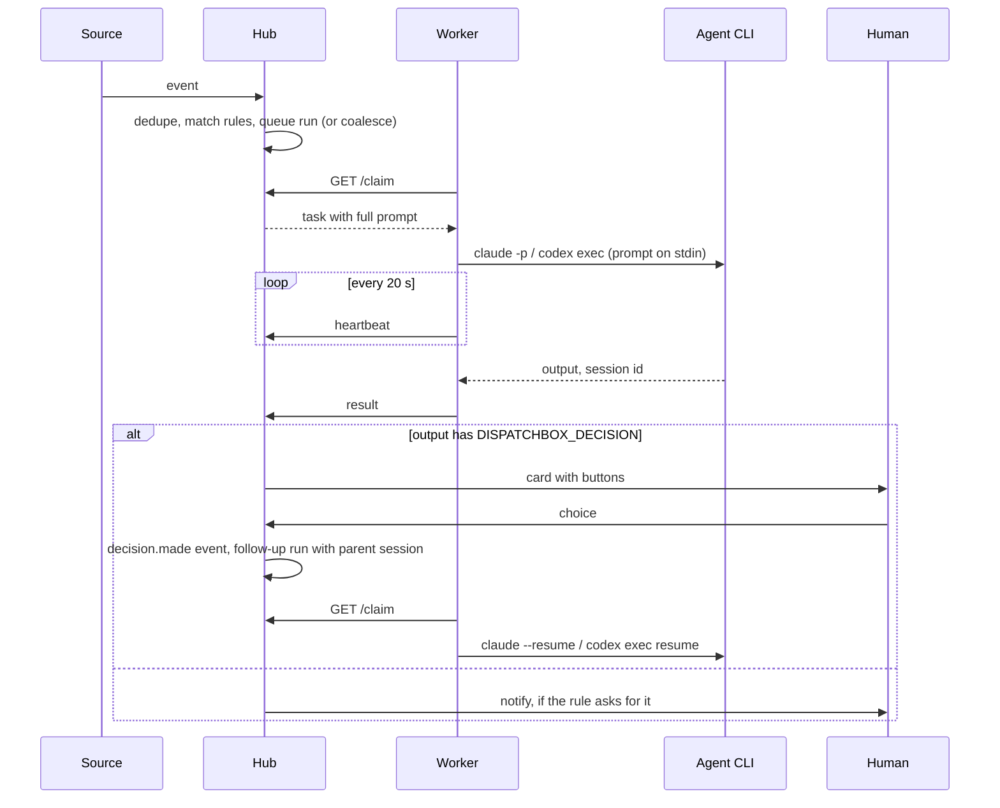

# Architecture

dispatchbox is about 2,700 lines of Python using only the standard library. This page explains how the pieces fit, for people who want to change the code or check that it does what they need.

## Overview

  

The hub never connects to a worker. Workers connect out to the hub, so they can sit behind NAT or a firewall.

## A run from start to finish

## Modules

| Module | Lines | Responsibility |
|---|---|---|
| `hub.py` | ~550 | Event ingest and dedupe, rule matching, the run lifecycle, decisions, retries, cron ticks, prompt building, notifications |
| `server.py` | ~480 | `ThreadingHTTPServer`: the API, GitHub webhook mapping, the dashboard, the background loop |
| `worker.py` | ~310 | Long-poll client, runner commands, output parsing, heartbeats, timeouts |
| `feishu.py`, `slack.py` | ~300, ~250 | Request verification, message to event, cards, button clicks |
| `rules.py` | ~240 | Rules file loading and validation, event normalisation, templating |
| `chat.py` | ~210 | What both chat platforms share: allowlists, origin tracking, answer text |
| `__main__.py` | ~130 | The command line |
| `store.py` | ~100 | SQLite schema and migrations |
| `cron.py` | ~60 | Five-field cron expressions |
| `net.py` | ~30 | One TLS context for outgoing HTTPS, with a `certifi` fallback |

## Design decisions

**Pull, not push.** Workers long-poll `GET /claim` for up to 50 seconds at a time. The hub answers as soon as a run is queued. This removes the need for inbound connections to workers, and makes "which machine runs this" a matter of which worker asks.

**The agent is a CLI.** dispatchbox does not call model APIs and holds no model keys. It runs the same `claude` or `codex` you use by hand, signed in the same way, with the same local tools and config. The cost is a dependency on those CLIs' output formats.

**Prompts are the protocol.** The agent reports back with plain lines (`DISPATCHBOX_DECISION`, `DISPATCHBOX_STATUS`, `DISPATCHBOX_SUMMARY`) that the hub appends instructions for. This works with any agent that can follow instructions, at the cost of relying on the agent to follow them. A missing status line counts as success if the process exited 0.

**A decision is just another event.** Answering a question emits `dispatchbox/decision.made`, which goes through the same rules as everything else. The follow-up rule chooses the prompt and permissions, and the hub passes the parent run's session ID so the worker can resume it.

**One lock, one database.** All hub state is in one SQLite file in WAL mode, behind one lock. Each HTTP request runs on its own thread. This is simple and enough for one team's events. It is not built to scale out.

**Background loop.** One thread wakes every second: it fires cron schedules once per minute and every 15 seconds marks runs whose worker went silent as `lost`, queueing retries where allowed. Notifications and chat calls run on short-lived threads so a slow API never blocks a request.

## Data model

Three tables, defined in `store.py`:

- **events**: every event received, with its status (`routed`, `coalesced`, `duplicate`, `unmatched`).
- **runs**: one row per attempt. Holds the rule spec as JSON, the rendered prompt, status, timing, exit code, summary, the last 8,000 characters of output, session ID, decision request and answer, cost and tokens, `parent_run` for follow-ups and `retry_of` for retries.
- **run_events**: which events belong to which run. A run has several when events were coalesced.

## Chat adapters

`ChatAdapter` in `chat.py` is the extension point. An adapter handles its own `/hooks/<name>` requests, and the hub calls it after every run finishes. It finds where a run came from by walking `parent_run` and `retry_of` back to the original chat event, so follow-ups and retries are answered in the same thread. See [CONTRIBUTING.md](../CONTRIBUTING.md#adding-a-chat-platform) for adding one.

## Tests

`tests/` drives the whole system in-process: a real hub and HTTP server on a random port, real workers, and a fake `claude` script that prints scripted answers. The chat tests run Slack and Feishu against a fake API server. Nothing calls a real model or a real chat service.
